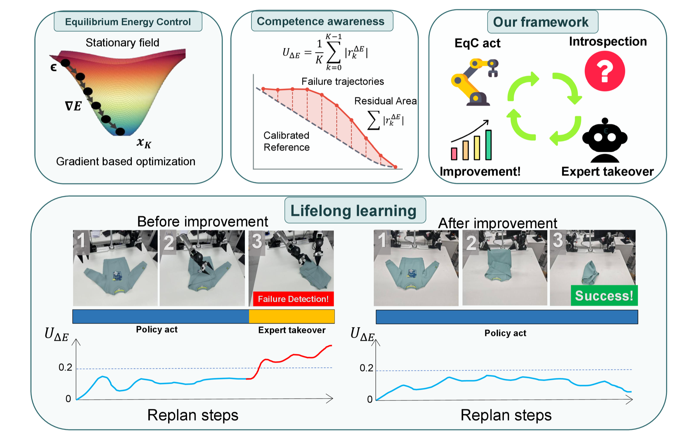

<div align="center">

# EqC: Equilibrium Energy Control for Introspective Lifelong Robot Learning

**Haodong Yang**<sup>1,\*</sup> &nbsp;
[**Runhan Huang**](https://hrh6666.github.io/)<sup>1,\*,†</sup> &nbsp;
**Bowen Zhang**<sup>1,2,\*</sup> &nbsp;
**Iofai Lei**<sup>1,\*</sup> &nbsp;
[**Zunzhe Zhang**](https://scholar.google.com/citations?user=2W320-8AAAAJ&hl=en)<sup>1</sup>
<br>
[**Xiangcheng Zhang**](https://scholar.google.com/citations?user=pBnAahcAAAAJ&hl=en)<sup>1</sup> &nbsp;
[**Shaoting Zhu**](https://zst1406217.github.io/)<sup>1,2</sup> &nbsp;
[**Linzhan Mou**](https://linzhanm.github.io/)<sup>3</sup> &nbsp;
[**Yicheng Liu**](https://mrmoore98.github.io/liuyicheng/)<sup>1,2</sup> &nbsp;
[**Hang Zhao**](https://hangzhaomit.github.io/)<sup>1,2,‡</sup>

<sup>1</sup>Tsinghua University &nbsp;&nbsp;
<sup>2</sup>Galaxea AI &nbsp;&nbsp;
<sup>3</sup>Princeton University

<sup>\*</sup>Equal contribution, random order &nbsp;&nbsp;
<sup>†</sup>Project lead &nbsp;&nbsp;
<sup>‡</sup>Corresponding author

</div>

<p align="center">
  
</p>

**Overview of EqC.** *Top:* EqC generates actions through energy-based refinement, while the geometry of the
refinement path reveals when autonomous execution is weakly supported. Energy-Gated DAgger uses this signal to trigger
expert takeover and subsequent policy improvement. *Bottom:* In real-world deployment, persistent U<sub>ΔE</sub>
alarms prompt timely assistance before failure, progressively converting assisted interventions into fully autonomous
execution through lifelong learning.

## Abstract

Long-term robot autonomy depends on more than effective action generation: a policy must recognize when its behavior is
no longer sufficiently supported and use assistance to improve. We introduce **Equilibrium Energy Control (EqC)**, a
framework for introspective lifelong robot learning built around an explicit conditional energy landscape. EqC casts
generative action refinement as equilibrium-seeking optimization, while the geometry of the refinement process reveals
whether the generated behavior remains consistent with the learned landscape. This competence signal enables
Energy-Gated DAgger, where persistent energy-consistency violations trigger expert takeover and the resulting recovery
trajectories are aggregated for subsequent policy updates. EqC integrates naturally into both Diffusion Transformer
policies and flow-matching-based vision-language-action (VLA) policies. Across simulation and real-world bimanual
manipulation, EqC matches or improves control performance and robustness while enabling timely intervention near the
policy's competence boundary.

This repository contains the official implementation of the EqC **Diffusion Transformer (DiT) policy on LIBERO**:
the equilibrium energy objective, energy-gradient action refinement, and the LIBERO training and evaluation pipeline.

## Repository layout

```text
eqc.py                       Hydra entry point
conf/config.yaml             Default training and inference configuration
eqc/model.py                 Energy model, objective, and action refinement
eqc/pipeline.py              LIBERO data loading, training, and evaluation
policy/eqc/                  Transport and interpolation utilities
policy/eqc_samplers/         Energy-gradient refinement sampler
policy/eqc_step_schedulers/  Fixed custom refinement schedule
policy/eqc_stoppers/         Fixed-budget stopper
scripts/train_libero.sh      Training wrapper
scripts/eval_libero.sh       Evaluation wrapper
```

## Setup

The implementation depends on the `lightning` branch of
[CleanDiffuser](https://github.com/CleanDiffuserTeam/CleanDiffuser), plus a
LIBERO installation and the LIBERO datasets converted to the `.zarr` format
expected by CleanDiffuser.

```bash
conda create -n eqc python=3.10
conda activate eqc
pip install -r requirements.txt
git clone https://github.com/CleanDiffuserTeam/CleanDiffuser.git
cd CleanDiffuser
git checkout lightning
pip install -e .
```

Install LIBERO following the CleanDiffuser documentation. Downloading the
pretrained T5 and DINOv2 backbones requires access to Hugging Face on the first
run. The tested setup uses Python 3.10 and CUDA-enabled PyTorch.

### Dataset layout

`DATASET_ROOT` must contain the `.zarr` archive for every suite that will be
used. For example:

```text
DATASET_ROOT/
├── libero_goal.zarr
├── libero_spatial.zarr
├── libero_object.zarr
└── libero_10.zarr
```

The supported suite names are `libero_goal`, `libero_spatial`,
`libero_object`, and `libero_10`.

## Training

Set `DATASET_ROOT` to the directory containing files such as
`libero_goal.zarr`.

```bash
bash scripts/train_libero.sh DATASET_ROOT RUNS_DIR libero_goal 0
```

For example, the following trains LIBERO-Goal for 40,000 optimization steps:

```bash
PYTHON=python bash scripts/train_libero.sh \
  /path/to/libero_zarr \
  /path/to/runs \
  libero_goal \
  0 \
  training.steps=40000
```

The generic Hydra equivalent is:

```bash
python eqc.py mode=training task_suite=libero_goal \
  paths.dataset_root=DATASET_ROOT paths.save_root=RUNS_DIR devices=[0]
```

By default, the global batch size is 256 and checkpoints are written every
2,500 train steps to:

```text
RUNS_DIR/TASK_SUITE/checkpoints/step=STEP.ckpt
```

All configuration values can be overridden with Hydra. Useful examples are:

```bash
training.steps=40000
training.dataloader.batch_size=128
training.checkpoint_interval=5000
training.resume_ckpt=/path/to/step=25000.ckpt
seed=1
```

The wrapper accepts additional overrides after its first four positional
arguments. For a two-GPU run, expose both GPUs and override the device list:

```bash
PYTHON=python bash scripts/train_libero.sh \
  /path/to/libero_zarr /path/to/runs libero_goal 0,1 \
  devices='[0,1]'
```

Weights & Biases is disabled by default. It can be enabled with your own
account, for example:

```bash
wandb.enabled=true wandb.mode=online wandb.project=eqc wandb.name=my_run
```

## Evaluation

```bash
bash scripts/eval_libero.sh DATASET_ROOT CHECKPOINT libero_goal 0
```

The checkpoint path may contain `=` (for example `step=40000.ckpt`); the
provided wrapper handles that safely. For a fast end-to-end smoke test, run one
task with one initial state:

```bash
PYTHON=python bash scripts/eval_libero.sh \
  /path/to/libero_zarr /path/to/step=40000.ckpt libero_goal 0 \
  'inference.task_ids=[0]' \
  inference.max_init_states=1 \
  inference.max_workers=1
```

Evaluation prints every trial's success status, each task's number of
successful trials, and the overall success rate. It does not write energy,
gradient, or per-step trace logs.

To retain the standard output as an evaluation record:

```bash
PYTHON=python bash scripts/eval_libero.sh \
  /path/to/libero_zarr /path/to/step=40000.ckpt libero_goal 0 \
  > eval_libero_goal.log 2>&1
```

## Configuration

`conf/config.yaml` contains the model and the fixed 32-step action-refinement
schedule. This release includes only energy-gradient refinement, the explicit custom
schedule, and fixed-budget inference. It intentionally has no machine-specific
paths. All paths must be supplied through Hydra overrides or local edits.

The released configuration contains only the sampler, scheduler, and stopper
used for this implementation:

- `gd`: iterative energy-gradient ascent/refinement;
- `custom`: the fixed 32-element step-size schedule;
- `null`: always use the whole refinement budget.

## Offline use and reproducibility

After the pretrained T5 and DINOv2 files have been downloaded once, evaluation
or training can run without network access by pointing Hugging Face to a local
cache:

```bash
export HF_HOME=/path/to/hf_cache
export HF_HUB_OFFLINE=1
```

Unset `HF_HUB_OFFLINE` for the first run, or when a required model is not yet
cached. For reproducible reporting, record the checkpoint step, suite,
inference seed, and the 32-step schedule in addition to the success rate.

## Citation

BibTeX coming soon.

## License

This project is released under the [MIT License](LICENSE).

## Contact

For questions about the paper or code, please open an issue or contact Hang Zhao
(hangzhao@mail.tsinghua.edu.cn).

## Acknowledgements

This implementation builds on
[CleanDiffuser](https://github.com/CleanDiffuserTeam/CleanDiffuser) and LIBERO.
Please follow the licenses and citation requirements of those projects when
using their code, models, or data.
